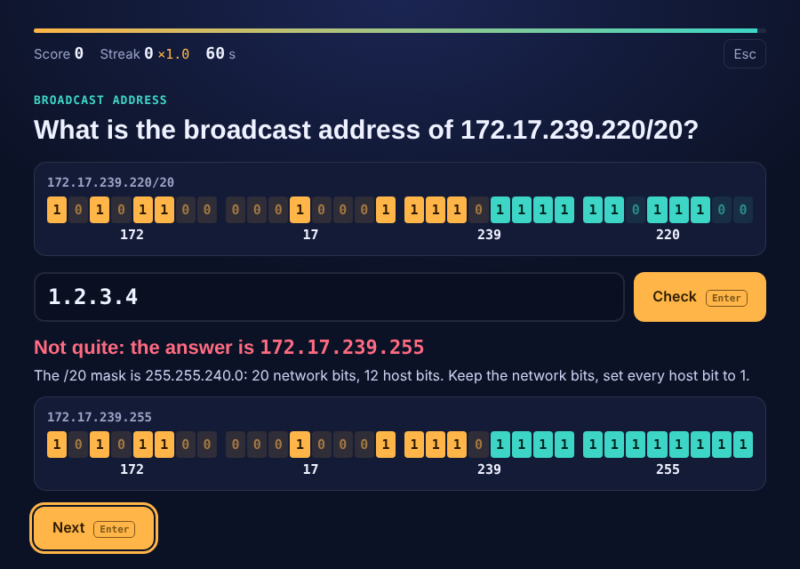

# Subnet Sprint

**A 60-second subnetting game.** Network and broadcast addresses, masks, prefix lengths, host counts, "are these two in the same subnet?". Every wrong answer comes with the 32 bits that explain it.

**Play:** https://dav1dushka.github.io/subnet-sprint/


## Why

Subnetting is a skill you either practise or forget, and most practice tools only tell you *that* you were wrong. Here a mistake shows the address in binary: **network bits in amber, host bits in teal**. Setting the teal part to all zeros gives the network address; all ones gives the broadcast. After a few rounds you stop calculating and start seeing it.



## How to play

- **Sprint**: 60 seconds, as many correct answers as you can. A streak raises the multiplier (×1.5 after 3, up to ×3). Mistakes cost time because you stop to read why.
- **Practice**: no timer, every answer explained.
- **Levels**: *Easy* uses /8, /16 and /24; *Medium* /17 to /30; *Hard* anything from /1 to /32, including the /31 and /32 edge cases.
- The game keeps track of what you get wrong and asks those question types more often. The summary suggests a topic to practise.

Keyboard first: type an answer and press <kbd>Enter</kbd>, <kbd>Y</kbd>/<kbd>N</kbd> for yes-no questions, <kbd>Esc</kbd> to stop. Prefixes can be typed as `24` or `/24`.


## Question types

| Type | Example |
| --- | --- |
| Network address | What is the network address of `172.16.5.10/20`? |
| Broadcast address | What is the broadcast address of `10.1.77.200/19`? |
| First / last usable host | First usable host in `192.168.1.130/26`? |
| Usable hosts | How many usable hosts does a `/27` have? |
| Prefix → mask | Write `/21` as a dotted mask |
| Mask → prefix | Which prefix is `255.255.252.0`? |
| Same subnet? | Are `192.168.1.10` and `192.168.1.200` in the same `/25`? |
| Right-size a subnet | Smallest subnet that fits 50 hosts? |

Edge cases follow common practice: a `/31` has 2 usable addresses (point-to-point links, RFC 3021) and a `/32` is a single host; when right-sizing a subnet for N hosts the classic rule `2^(32-p) − 2 ≥ N` applies, so 2 hosts need a `/30`.

## Code

```
src/net.ts        IPv4 maths on 32-bit unsigned integers (parse, mask, network, broadcast, host counts)
src/questions.ts  question generator: seeded RNG, difficulty levels, answer normalisation, weak-topic weighting
src/main.ts       screens and game loop (plain TypeScript and DOM, no framework)
site/index.html   page and styles
tests/            node:test suite
```

The generator is deterministic for a given seed, so the tests can generate thousands of questions and check that each one accepts its own answer, rejects a wrong one, and that "same subnet?" questions are balanced between yes and no.

```bash
npm install
npm test           # unit tests
npm run typecheck  # strict TypeScript
npm run build      # site/game.js; open site/index.html
```

## License

MIT
