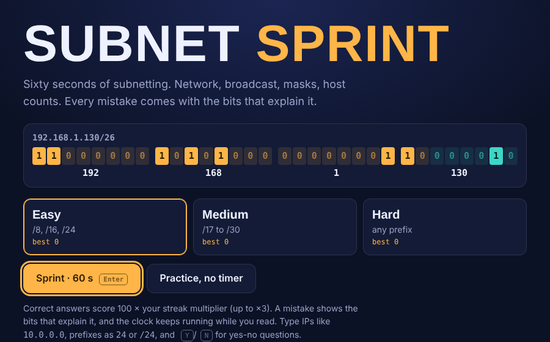
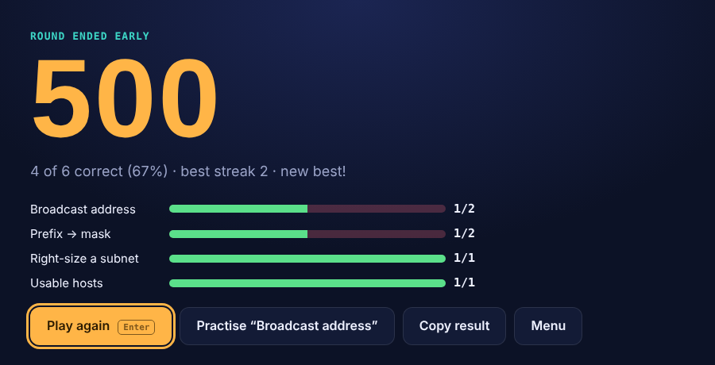

# Subnet Sprint

🇷🇺 [Русская версия ниже](#ru)

**A 60-second subnetting game.** Network and broadcast addresses, masks, prefix lengths, host counts, "are these two in the same subnet?". Every wrong answer comes with the 32 bits that explain it.

**Play:** https://dav1dushka.github.io/subnet-sprint/



## Why

Subnetting is a skill you either practise or forget, and most practice tools only tell you *that* you were wrong. Here a mistake shows the address in binary: **network bits in amber, host bits in teal**. Setting the teal part to all zeros gives the network address; all ones gives the broadcast. After a few rounds you stop calculating and start seeing it.


## How to play

- **Sprint**: 60 seconds, as many correct answers as you can. A streak raises the multiplier (×1.5 after 3, up to ×3). Mistakes cost time because you stop to read why.
- **Practice**: no timer, every answer explained.
- **Levels**: *Easy* uses /8, /16 and /24; *Medium* /17 to /30; *Hard* anything from /1 to /32, including the /31 and /32 edge cases.
- The game keeps track of what you get wrong and asks those question types more often. The summary suggests a topic to practise.

Keyboard first: type an answer and press <kbd>Enter</kbd>, <kbd>Y</kbd>/<kbd>N</kbd> for yes-no questions, <kbd>Esc</kbd> to stop. Prefixes can be typed as `24` or `/24`.



## Question types

| Type | Example |
| --- | --- |
| Network address | What is the network address of `172.16.5.10/20`? |
| Broadcast address | What is the broadcast address of `10.1.77.200/19`? |
| First / last usable host | First usable host in `192.168.1.130/26`? |
| Usable hosts | How many usable hosts does a `/27` have? |
| Prefix → mask | Write `/21` as a dotted mask |
| Mask → prefix | Which prefix is `255.255.252.0`? |
| Same subnet? | Are `192.168.1.10` and `192.168.1.200` in the same `/25`? |
| Right-size a subnet | Smallest subnet that fits 50 hosts? |

Edge cases follow common practice: a `/31` has 2 usable addresses (point-to-point links, RFC 3021) and a `/32` is a single host; when right-sizing a subnet for N hosts the classic rule `2^(32-p) − 2 ≥ N` applies, so 2 hosts need a `/30`.

## Code

```
src/net.ts        IPv4 maths on 32-bit unsigned integers (parse, mask, network, broadcast, host counts)
src/questions.ts  question generator: seeded RNG, difficulty levels, answer normalisation, weak-topic weighting
src/main.ts       screens and game loop (plain TypeScript and DOM, no framework)
site/index.html   page and styles
tests/            node:test suite
```

The generator is deterministic for a given seed, so the tests can generate thousands of questions and check that each one accepts its own answer, rejects a wrong one, and that "same subnet?" questions are balanced between yes and no.

```bash
npm install
npm test           # unit tests
npm run typecheck  # strict TypeScript
npm run build      # site/game.js; open site/index.html
```

## License

MIT

---

<a id="ru"></a>

# Subnet Sprint — по-русски

**Игра на 60 секунд про подсети.** Адреса сети и broadcast, маски, длины префиксов, количество хостов, «в одной ли подсети эти два адреса?». К каждому неверному ответу показываются 32 бита, которые объясняют ошибку.

**Играть:** https://dav1dushka.github.io/subnet-sprint/

## Зачем

Расчёт подсетей — навык, который либо тренируешь, либо забываешь, а большинство тренажёров сообщают только *что* ты ошибся. Здесь ошибка показывает адрес в двоичном виде: **биты сети — янтарные, биты хоста — бирюзовые**. Если бирюзовую часть заполнить нулями, получится адрес сети, если единицами — broadcast. Через несколько раундов перестаёшь считать и начинаешь видеть.

## Как играть

- **Спринт**: 60 секунд, как можно больше верных ответов. Серия увеличивает множитель (×1,5 после трёх подряд, максимум ×3). Ошибки стоят времени, потому что ты останавливаешься прочитать объяснение.
- **Тренировка**: без таймера, объяснение к каждому ответу.
- **Уровни**: *Easy* — /8, /16 и /24; *Medium* — от /17 до /30; *Hard* — любой префикс от /1 до /32, включая крайние случаи /31 и /32.
- Игра запоминает, в чём ты ошибаешься, и чаще задаёт такие вопросы. В итогах раунда она предлагает тему для тренировки.

Всё с клавиатуры: вводишь ответ и жмёшь <kbd>Enter</kbd>, <kbd>Y</kbd>/<kbd>N</kbd> для вопросов «да/нет», <kbd>Esc</kbd> — остановиться. Префикс можно писать как `24` или `/24`.

## Типы вопросов

| Тип | Пример |
| --- | --- |
| Адрес сети | Какой адрес сети у `172.16.5.10/20`? |
| Адрес broadcast | Какой broadcast у `10.1.77.200/19`? |
| Первый / последний хост | Первый доступный хост в `192.168.1.130/26`? |
| Число хостов | Сколько доступных хостов в `/27`? |
| Префикс → маска | Запиши `/21` в виде маски |
| Маска → префикс | Какой префикс у `255.255.252.0`? |
| Одна подсеть? | `192.168.1.10` и `192.168.1.200` в одной `/25`? |
| Подобрать подсеть | Самая маленькая подсеть на 50 хостов? |

Крайние случаи — по общепринятой практике: в `/31` два доступных адреса (каналы точка-точка, RFC 3021), `/32` — один хост. При подборе подсети на N хостов действует классическое правило `2^(32-p) − 2 ≥ N`, поэтому для 2 хостов нужна `/30`.

## Код

```
src/net.ts        математика IPv4 на беззнаковых 32-битных числах (разбор, маска, сеть, broadcast, число хостов)
src/questions.ts  генератор вопросов: RNG с seed, уровни сложности, нормализация ответов, упор на слабые темы
src/main.ts       экраны и игровой цикл (чистый TypeScript и DOM, без фреймворка)
site/index.html   страница и стили
tests/            тесты на node:test
```

При одном и том же seed генератор выдаёт одни и те же вопросы. Поэтому тесты генерируют тысячи вопросов и проверяют, что каждый принимает собственный ответ, отвергает неверный, а вопросы «одна подсеть?» поровну делятся на «да» и «нет».

```bash
npm install
npm test           # юнит-тесты
npm run typecheck  # строгий TypeScript
npm run build      # site/game.js; открой site/index.html
```

## Лицензия

MIT
